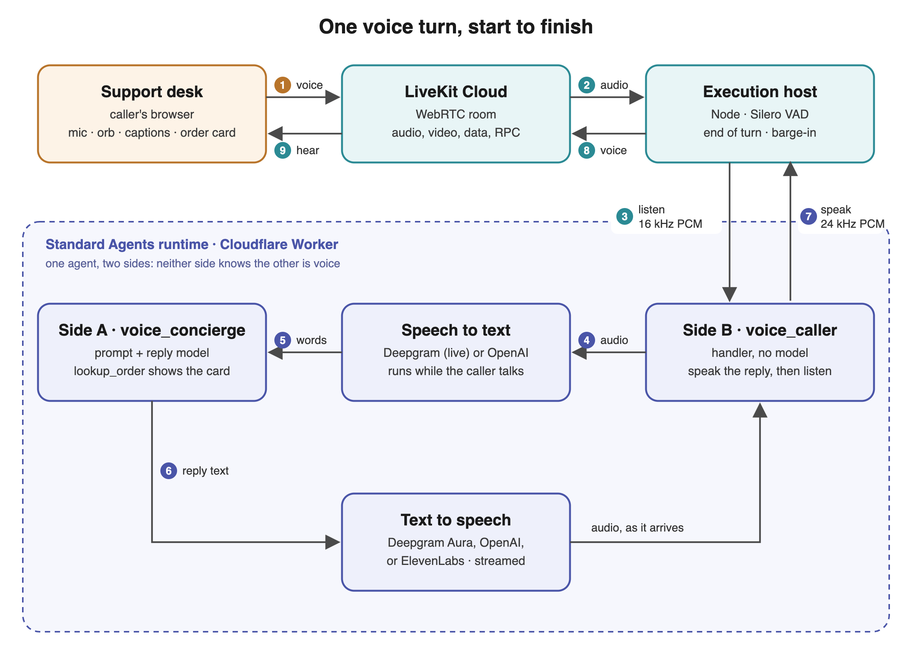

# Standard Agents × LiveKit: voice over runtime streams

A [Standard Agent](https://standardagentspec.org) that holds a real-time voice conversation in a [LiveKit](https://livekit.io) room. The agent never touches LiveKit. Audio moves through the spec's **runtime streams** (`state.runtimeStreams.open()`) to a small **execution host** that bridges a LiveKit room.

The Standard Agent Specification has no voice support today. This repo shows that the existing primitives are enough to build it, and where a spec-level voice capability could start.



## How a turn works

1. **Side A** is an ordinary prompt. It reads a transcript and writes a short text reply. It doesn't know it's on a call.
2. **Side B** is a handler (`voice_caller`), which is deterministic code with no model. On each reply it:
   - calls TTS from the Worker and **pipes the PCM into a `livekit.speak` stream** as it arrives, so playback starts before synthesis ends;
   - opens `livekit.listen` and reads the caller's next utterance back as PCM. With Deepgram, that audio is **transcribed live while the caller is still talking**, so the end of their turn leaves only a short flush;
   - keeps listening when the words trail off ("Okay, and…"), so a pause mid-sentence is not answered as a whole turn;
   - injects the transcript as side B's message, which starts side A's next turn.
3. The **host** plays audio into the room, runs Silero voice activity detection on the caller's mic, decides where the caller's turn ends, and handles barge-in.

A reply that also calls a tool ("Let me check that." plus `lookup_order`) is a preamble: side B speaks it but does not listen, because side A's real reply is still coming.

### Barge-in

If the caller talks over the agent, the host stops playback within about 240 ms and ends the speak stream with a report of how much audio was heard. The runtime's next write then fails, **which cancels the TTS request upstream**. The handler rewrites the interrupted reply in thread history to what the caller actually heard ("Welcome to the demo —"), keeping the full text in metadata. That way the model never believes it said things the caller didn't hear. The interrupting words carry into the next listen turn.

### Why split it this way

- **The agent package owns its vendor choices.** STT, TTS, and the LLM are all picked in agent code, the same way a Standard Agent pins its model. The host holds no provider keys.
- **The host is generic media plumbing.** It moves bytes and makes timing decisions (VAD, endpointing, barge-in) that must happen next to the audio, not across a network hop.
- **Voice is just a side.** Swap `voice_caller` for `{ human: true }` and the same prompt works as a text chat.

## Quick start

You need Node 22+, a LiveKit project ([LiveKit Cloud](https://cloud.livekit.io) works on the free tier), and an OpenAI API key for the reply model. Speech can use the same OpenAI key, or a [Deepgram](https://deepgram.com) key for the lowest latency (see [Choosing speech providers](#choosing-speech-providers)).

### 1. Create a LiveKit project

LiveKit carries the audio between the caller's browser and the agent. The free tier of LiveKit Cloud is enough for this demo.

1. Sign up at [cloud.livekit.io](https://cloud.livekit.io) and create a project. Any name works.
2. In the project, open **Settings → API keys** and select **Create key** (or open the key the project already has).
3. Copy three values. You'll paste them into `host/.env` in step 3:
   - **URL**: looks like `wss://your-project-abc123.livekit.cloud`
   - **API key**: starts with `API`
   - **API secret**: shown next to the key. Treat it like a password.

### 2. Start the agent

From the repo root, install everything once. This also builds the two packages in `packages/`.

```bash
npm install
cd agent
cp .dev.vars.example .dev.vars
```

Fill in `.dev.vars`. For the key, run `openssl rand -hex 16` in a terminal and paste the 32-character output; the file does not run commands.

```dotenv
ENCRYPTION_KEY=<output of openssl rand -hex 16>
SUPER_ADMIN_PASSWORD=<a password you choose>  # local admin UI only
OPENAI_API_KEY=sk-...
# DEEPGRAM_API_KEY=...   optional, for the fastest turns
```

```bash
npm run dev    # http://127.0.0.1:5173, sign in as "admin" with that password
```

### 3. Start the host

Leave the agent running. In a second terminal, from the repo root:

```bash
cd host
cp .env.example .env
```

Open `host/.env` and fill in four values: the password you chose in step 2, and the three LiveKit values from step 1.

```dotenv
SA_ADMIN_PASSWORD=<the SUPER_ADMIN_PASSWORD from agent/.dev.vars>
LIVEKIT_URL=wss://your-project-abc123.livekit.cloud
LIVEKIT_API_KEY=API...
LIVEKIT_API_SECRET=<your API secret>
```

`.env` is ignored by git, so these never leave your machine. Then run:

```bash
npm run probe           # optional: checks the stream plumbing, no LiveKit or API calls
npm start               # first copies the speech keys from agent/.dev.vars into the runtime
```

`npm start` creates a thread, attaches as its execution host, joins a LiveKit room, and prints a link:

```
  Open the support desk:
  http://127.0.0.1:8787/
```

Open it and press Start call. The page asks for the microphone only and shows the agent's orb. When the agent asks, say a three-digit order number. The demo has five:

| Order | Item | Status |
| --- | --- | --- |
| 111 | Linen throw blanket | In process |
| 222 | Ceramic pour-over set | Shipped |
| 333 | Wool overcoat | Delivered |
| 444 | Stoneware dinner plates | In process |
| 555 | Beeswax pillar candles | Shipped |

"111", "one one one", "triple one", and "one eleven" all work. The order card appears on the page, and you can ask follow-ups (when it arrives, where it ships, what it cost) or give another number. To add orders, edit `ORDERS` in `agent/src/orders.ts`.

Then try more than a status check:

- **"Where is it right now?"** shows a map of the route, where the package is, and the carrier's scan history (222 and 555 are on the road).
- **"Can you deliver it Monday and leave it at the side door?"** puts the change on screen and asks you to confirm. Say "yes" and the card updates.
- **"I'd like to return it."** on a delivered order (333) starts a return and shows a return code.

Changes take two steps. The model can only propose one (`request_delivery_change`, `request_return`). `confirm_change` applies it, and only when the caller's own latest words are a clear yes; the code checks the transcript, not the model's reading of it. Code also enforces the rules: no earlier delivery than planned, no Sundays, at most ten days out, and returns only once delivered. The admin UI's thread view shows the transcript and tool calls as you talk, and the host terminal logs every speak, listen, and order card.

`npm run probe` output looks like this:

```json
{
  "speak":  { "ok": true, "playedMs": 600, "totalMs": 600, "interrupted": false, "firstAudioMs": 16 },
  "listen": { "ok": true, "bytes": 51200, "speechMs": 1600 },
  "unknownCapability": { "code": "refused", "error": "This execution host has no \"livekit.does_not_exist\" capability." }
}
```

## The support desk

The desk at `http://127.0.0.1:8787/` is the caller's side of the call. It asks for the microphone only and shows:

- **the agent's orb**, a video track the host renders, with an audio-reactive ring drawn in the browser (amber while the agent speaks, cyan while you do);
- **live captions** for both sides. A reply you talked over is marked as interrupted;
- **the response time** of each turn in the header: from the end of your turn to the agent's first audio, which is the gap the caller actually hears. Green under 1.2 s, amber under 2 s;
- **a hint toast** with the demo order numbers, until the call gets going;
- **the order card**, when `lookup_order` finds one, updated after a confirmed change;
- **the tracking card**, a route map and scan timeline from `track_package`. The map is drawn in the page, with no map service or key;
- **a confirmation box** while a change waits for the caller's yes.

The carrier, "Parcelway", is fictional.

Captions and timings travel as LiveKit data packets on the `sa-voice.events` topic. Nothing in the call depends on them.

## Configuration

### Choosing speech providers

| Setup | Keys | Feel |
| --- | --- | --- |
| OpenAI for everything (default) | `OPENAI_API_KEY` | Simplest. Steerable, expressive voice. About 2–2.5 s per plain answer in our tests. |
| Deepgram STT + TTS, OpenAI reply model | `OPENAI_API_KEY`, `DEEPGRAM_API_KEY` | Fastest. Live transcription and about 0.3 s to first audio. About 1.5–1.8 s per plain answer. |
| ElevenLabs TTS | `ELEVENLABS_API_KEY`, `ELEVENLABS_VOICE_ID` | Most expressive voices. |

Put keys in `agent/.dev.vars`; `npm start` in `host/` copies them into the runtime as instance variables. Choose providers in `host/.env`, which passes the choice (never a key) to the thread:

```bash
VOICE_STT_PROVIDER=deepgram
VOICE_TTS_PROVIDER=deepgram
```

If Deepgram's live socket fails during a turn, that turn falls back to its batch endpoint. The `voice_heard` event reports `sttMode: live | batch`.

### Speech settings

These are agent-side, read through `state.env()`, so they can be set per instance, per user, or per thread:

| Variable | Values | Default |
| --- | --- | --- |
| `VOICE_STT_PROVIDER` | `openai`, `deepgram` | `openai` |
| `VOICE_TTS_PROVIDER` | `openai`, `elevenlabs`, `deepgram` | `openai` |
| `VOICE_STT_LANGUAGE` | language code | `en` (short clips are otherwise often transcribed as another language) |
| `VOICE_STT_KEYTERMS` | comma-separated words | `Harbor Goods, order number`. Passed to OpenAI as a prompt and to Deepgram as `keyterm` |
| `OPENAI_TTS_INSTRUCTIONS` | delivery direction | a warm, upbeat support voice |
| `OPENAI_STT_MODEL`, `OPENAI_TTS_MODEL`, `OPENAI_TTS_VOICE` | | `gpt-4o-mini-transcribe`, `gpt-4o-mini-tts`, `coral` |
| `DEEPGRAM_MODEL`, `DEEPGRAM_TTS_MODEL` | | `nova-3`, `aura-2-thalia-en` |
| `ELEVENLABS_MODEL` | | `eleven_flash_v2_5` |

The reply model is set in `agent/agents/models/voice_fast.ts`. It is the largest remaining share of each turn's latency, so a faster model is the next lever.

### Turn taking

These are host-side, in `host/.env`:

| Variable | Default | Notes |
| --- | --- | --- |
| `VAD_THRESHOLD` | `0.5` | Silero speech probability. Raise it if background noise interrupts the agent |
| `TURN_MIN_SPEECH_MS` | `240` | Speech needed before a turn starts (filters clicks and coughs) |
| `TURN_PREROLL_MS` | `300` | Audio kept from before the detected start |
| `BARGE_IN` / `BARGE_IN_MS` | `on` / `480` | Turn off for speakerphones without echo cancellation |
| `VAD_MARGIN_DB`, `VAD_MIN_SPEECH_DB` | `12`, `-48` | Only used by the loudness fallback, if Silero fails to load |

The end-of-turn silence window (400 ms) and the trailing-word check are chosen by the agent, in `packages/voice/src/turn.ts`, because how long to wait is a conversation-design decision.

## Packages

The voice bridge is two reusable npm packages. The demo in `agent/` and `host/` is built on them, and any other Standard Agent can be too.

| Package | Side | What it gives you |
| --- | --- | --- |
| [`standardagent-livekit-voice`](packages/voice) | runtime (agent code) | the `voice_caller` side B handler, the `end_call` tool, speak / listen / show / caption / hangup over runtime streams, STT and TTS providers, and the `livekit.*` capability protocol (`standardagent-livekit-voice/protocol`) |
| [`standardagent-livekit-host`](packages/host) | execution host (Node) | `startVoiceHost()`: creates a thread, serves the `livekit.*` capabilities, joins the LiveKit room, and runs Silero VAD, endpointing, and barge-in |

The voice package uses only `state.runtimeStreams`, `fetch`, and `WebSocket`, so it isn't tied to one runtime. The host speaks the Builder's bridge protocol today ([docs/bridge-protocol.md](docs/bridge-protocol.md)).

## Layout

`agent/agents/` follows the Standard Agents Builder's standard layout: one folder per kind of definition (`agents/`, `handlers/`, `prompts/`, `tools/`, `models/`), discovered by the Builder's Vite plugin. That is why the path reads `agent/agents/agents/`. Keeping the standard layout means the agent package looks like any other Standard Agents project.

```
packages/voice/                      standardagent-livekit-voice (runtime side)
  src/protocol.ts                      the capability contract, shared with the host
  src/turn.ts                          one voice turn: speak, listen, transcribe, inject
  src/streams.ts                       runtime side of speak / listen / show / caption / hangup
  src/providers.ts, src/config.ts      OpenAI, Deepgram, ElevenLabs; chosen from thread env
  src/definitions.ts                   voice_caller handler and end_call tool options
packages/host/                       standardagent-livekit-host (execution host)
  src/host.ts                          startVoiceHost()
  src/bridge.ts                        execution-host side of the runtime stream protocol
  src/capabilities/                    speak (playback + barge-in), listen (endpointing), show, caption, hangup
  src/mic.ts, src/silero.ts, src/vad.ts  20 ms framing, Silero VAD, loudness fallback, pre-roll
  src/room.ts, src/events.ts           LiveKit room, orb track, caller mic, captions and timing
agent/                               demo: Standard Agents Builder project
  agents/agents/voice_concierge.ts     side A prompt + side B voice handler
  agents/handlers/voice_caller.ts      wraps the package's handler
  agents/prompts/voice_concierge.ts    spoken-style prompt; knows about interruptions
  agents/models/voice_fast.ts          the reply model
  agents/tools/                        lookup_order, track_package, request_delivery_change,
                                       request_return, confirm_change, end_call
  agents/agents/stream_probe.ts        keyless self-test agent
  src/orders.ts                        the demo order book and spoken-number parsing
  src/fulfillment.ts                   tracking routes, spoken-day parsing, change and return rules
  src/call-state.ts                    the order on screen, saved changes, and the pending change
host/                                demo: runs startVoiceHost() and serves the caller's page
  src/index.ts, src/config.ts          wiring and host/.env settings
  src/desk.ts, desk/                   the support desk page
docs/bridge-protocol.md              how a host attaches to Builder, and spec notes
```

## Tests

```bash
npm test          # 41 tests across packages/host and host, a few seconds
npm run typecheck
```

The suite runs the agent's real runtime-side stream code against the host's real bridge client over a WebSocket. A mock runtime copies the Builder's stream semantics. It covers playback, barge-in with TTS cancellation, pre-roll after an interruption, endpointing, silence timeouts, refused capabilities, runtime aborts, TTS failures, Silero on recorded speech, order lookup and spoken-number parsing, Deepgram live transcription against a fake socket (including fallback), and the turn-level guards (trailing words, tool preambles, duplicated replies).

`npm run probe` checks the stream plumbing against a real Builder dev server without LiveKit or any API calls.

## Limitations and next steps

- **The reply is spoken only once it is fully written.** Side B receives side A's message when it completes, so TTS cannot start on the first sentence. Streaming message deltas to handlers would be a useful spec addition.
- **A lookup costs two model calls**: one to call the tool, one to phrase the result.
- **The trailing-word check is a heuristic.** A pause after a complete-sounding phrase still ends the turn. LiveKit's semantic turn detector would be the production choice.
- **Live STT is Deepgram only.** OpenAI transcribes after the turn ends.
- **The interrupted-reply estimate is proportional.** It uses played time over total audio time. TTS word timestamps would make it exact.
- **One caller per room** and one call per host process.
- **The bridge protocol is the Builder's, not the spec's.** See [docs/bridge-protocol.md](docs/bridge-protocol.md).
- The Standard Agents Builder runtime is licensed for local development and for production on Standard Agents hosting. This demo runs locally.

## Third-party components

- [Silero VAD](https://github.com/snakers4/silero-vad) (`packages/host/models/silero_vad.onnx`), MIT license.
- The product photos in `host/desk/products/` are AI-generated for this demo and are shared under the repository's MIT license.
- `@livekit/noise-cancellation-node` filters background noise on the caller's mic. It works with LiveKit Cloud; elsewhere the host logs a warning and continues without it.

## License

MIT
