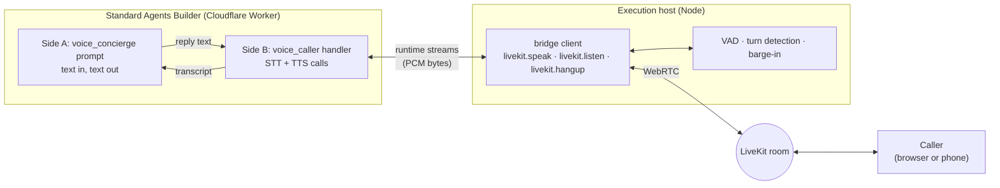

# Standard Agents × LiveKit: voice over runtime streams

A [Standard Agent](https://standardagentspec.org) that holds a real-time voice conversation in a [LiveKit](https://livekit.io) room. The agent never touches LiveKit. Audio moves through the spec's **runtime streams** (`state.runtimeStreams.open()`) to a small **execution host** that bridges a LiveKit room.

The Standard Agent Specification has no voice support today. This repo shows that the existing primitives are enough to build it, and where a spec-level voice capability could start.



## How a turn works

1. **Side A** is an ordinary prompt. It reads a transcript and writes a short text reply. It doesn't know it's on a call.
2. **Side B** is a handler (`voice_caller`), which is deterministic code with no model. On each reply it:
   - calls TTS from the Worker and **pipes the PCM into a `livekit.speak` stream** as it arrives, so playback starts before synthesis ends;
   - opens `livekit.listen` and reads the caller's next utterance back as PCM;
   - runs STT and injects the transcript as side B's message, which starts side A's next turn.
3. The **host** plays audio into the room, runs voice activity detection on the caller's mic, decides where the caller's turn ends, and handles barge-in.

### Barge-in

If the caller talks over the agent, the host stops playback within about 240 ms and ends the speak stream with a report of how much audio was heard. The runtime's next write then fails, **which cancels the TTS request upstream**. The handler rewrites the interrupted reply in thread history to what the caller actually heard ("Welcome to the demo —"), keeping the full text in metadata. That way the model never believes it said things the caller didn't hear. The interrupting words carry into the next listen turn.

### Why split it this way

- **The agent package owns its vendor choices.** STT, TTS, and the LLM are all picked in agent code, the same way a Standard Agent pins its model. The host holds no provider keys.
- **The host is generic media plumbing.** It moves bytes and makes timing decisions (VAD, endpointing, barge-in) that must happen next to the audio, not across a network hop.
- **Voice is just a side.** Swap `voice_caller` for `{ human: true }` and the same prompt works as a text chat.

## Quick start

You need Node 22+, a LiveKit project ([LiveKit Cloud](https://cloud.livekit.io) works on the free tier), and an OpenAI API key (for the reply model, STT, and TTS).

### 1. Start the agent

```bash
cd agent
npm install
cp .dev.vars.example .dev.vars
```

Fill in `.dev.vars`:

```bash
ENCRYPTION_KEY=$(openssl rand -hex 16)   # exactly 32 characters
SUPER_ADMIN_PASSWORD=pick-a-local-password
OPENAI_API_KEY=sk-...
```

```bash
npm run dev    # http://127.0.0.1:5173, sign in as "admin" with that password
```

### 2. Start the host

```bash
cd host
npm install
cp .env.example .env    # set SA_ADMIN_PASSWORD and the three LIVEKIT_* values
npm run sync-keys       # copies the speech keys from agent/.dev.vars into the runtime's variables
npm run probe           # optional: checks the stream plumbing, no LiveKit or API calls
npm start
```

`npm start` creates a thread, attaches as its execution host, joins a LiveKit room, and prints a link:

```
  Join the call:
  https://meet.livekit.io/custom?liveKitUrl=...&token=...
```

Open it, allow the microphone, and the agent greets you. The admin UI's thread view shows the transcript and tool calls as you talk, and the host terminal logs every speak, listen, and barge-in with timestamps.

`npm run probe` output looks like this:

```json
{
  "speak":  { "ok": true, "playedMs": 600, "totalMs": 600, "interrupted": false, "firstAudioMs": 16 },
  "listen": { "ok": true, "bytes": 51200, "speechMs": 1600 },
  "unknownCapability": { "code": "refused", "error": "This execution host has no \"livekit.does_not_exist\" capability." }
}
```

## Configuration

**Speech providers.** These are agent-side, read through `state.env()`, so they can be set per instance, per user, or per thread:

| Variable | Values | Default |
| --- | --- | --- |
| `VOICE_STT_PROVIDER` | `openai`, `deepgram` | `openai` |
| `VOICE_TTS_PROVIDER` | `openai`, `elevenlabs` | `openai` |
| `OPENAI_API_KEY` / `DEEPGRAM_API_KEY` / `ELEVENLABS_API_KEY` | keys | none |
| `ELEVENLABS_VOICE_ID` | voice id | none (required for ElevenLabs) |
| `OPENAI_STT_MODEL`, `OPENAI_TTS_MODEL`, `OPENAI_TTS_VOICE`, `DEEPGRAM_MODEL`, `ELEVENLABS_MODEL` | model names | `gpt-4o-mini-transcribe`, `gpt-4o-mini-tts`, `coral`, `nova-3`, `eleven_flash_v2_5` |

To use Deepgram and ElevenLabs, add their keys to `agent/.dev.vars`, run `npm run sync-keys` again, and set `VOICE_STT_PROVIDER` / `VOICE_TTS_PROVIDER` in `host/.env`. The host passes those choices (never keys) as thread env.

**Turn taking.** These are host-side, in `host/.env`:

| Variable | Default | Notes |
| --- | --- | --- |
| `VAD_MARGIN_DB` | `12` | How far above the learned noise floor speech must be |
| `VAD_MIN_SPEECH_DB` | `-48` | Lower it for soft-spoken callers |
| `TURN_MIN_SPEECH_MS` | `160` | Speech needed before a turn starts (filters clicks and coughs) |
| `TURN_PREROLL_MS` | `300` | Audio kept from before the detected start |
| `BARGE_IN` / `BARGE_IN_MS` | `on` / `240` | Turn off for speakerphones without echo cancellation |

The end-of-turn silence window (700 ms) is chosen by the agent, in `src/voice/turn.ts`, because how long to wait is a conversation-design decision.

## Layout

```
agent/                         Standard Agents Builder project
  agents/agents/voice_concierge.ts   side A prompt + side B voice handler
  agents/handlers/voice_caller.ts    the voice side (calls src/voice/turn.ts)
  agents/prompts/voice_concierge.ts  spoken-style prompt; knows about interruptions
  agents/tools/                      save_note, end_call
  agents/agents/stream_probe.ts      keyless self-test agent
  src/voice/protocol.ts              the capability contract, shared with the host
  src/voice/streams.ts               runtime side of speak / listen / hangup
  src/voice/providers.ts             OpenAI, Deepgram, ElevenLabs over fetch
host/                          Node execution host
  src/bridge.ts                      execution-host side of the runtime stream protocol
  src/capabilities/                  speak (playback + barge-in), listen (endpointing), hangup
  src/mic.ts, src/vad.ts             20 ms framing, VAD, pre-roll ring buffer
  src/room.ts                        LiveKit room, agent voice track, caller mic
docs/bridge-protocol.md        how a host attaches to Builder, and spec notes
```

## Tests

```bash
cd host && npm test     # 15 tests, about 2 s
```

The suite runs the agent's real runtime-side stream code against the host's real bridge client over a WebSocket. A mock runtime copies the Builder's stream semantics. The suite covers full playback, barge-in with TTS cancellation, pre-roll after an interruption, endpointing, silence timeouts, refused capabilities, runtime aborts, and TTS failures.

Everything was also run against a real Standard Agents Builder 0.45.10 dev server: `npm run probe`, plus a scripted conversation through the production `runVoiceTurn` with a simulated barge-in. That run confirmed the history rewrite, the transcript injection, `end_call`, and hangup.

## Limitations and next steps

- **Turn detection is energy-based.** It's simple and dependency-free. Silero VAD or LiveKit's semantic turn detector would be the production choice. The capability handlers only consume a per-frame speech flag, so either drops in.
- **STT is batch.** The utterance is transcribed after the turn ends. Streaming STT from the Worker (for example, a Deepgram WebSocket fed while `listen` is still open) would cut about a second of latency.
- **The interrupted-reply estimate is proportional.** It uses played time over total audio time. TTS word timestamps would make it exact.
- **One caller per room** and one call per host process.
- **The bridge protocol is the Builder's, not the spec's.** See [docs/bridge-protocol.md](docs/bridge-protocol.md).
- The Standard Agents Builder runtime is licensed for local development and for production on Standard Agents hosting. This demo runs locally.

## License

MIT
